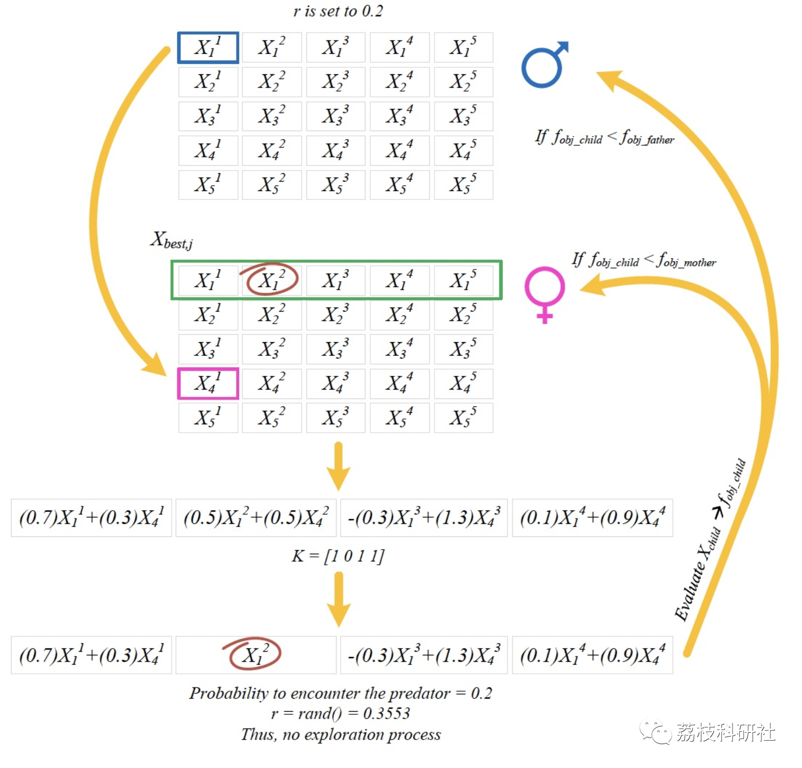
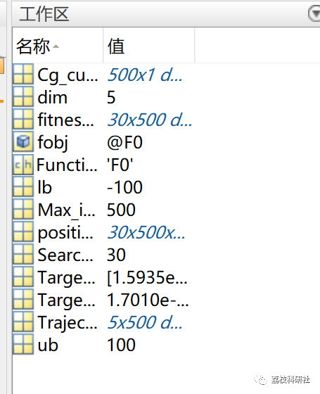

# Evolutionary mating algorithm (EMA) based on the use of Hardy-Weinberg equilibrium and crossover index in random mating (Matlab code implementation)

💥💥💥💞💞💞💞 Welcome to this blog❤️❤️❤️💥💥💥
🏆 Bloggers' Advantage: 🌞🌞🌞 The content of the blog strives to be rigorous in thought and clear in logic, for the convenience of readers.
⛳️ Mantra: The journey of a hundred miles is half done in the last ninety.
Litchi Research Society
Code Collection: Power System, Intelligent Algorithms and Applications, Neural Network Prediction, Path Planning, Optimized Scheduling, Workshop Scheduling, Image Processing, Signal Processing...
🎁Column Directory Link:
🌈🌈🌈🌟🌟🌟Electrical Code Intelligent Algorithm and Its Application Path Planning Neural Network Predictive Optimization Scheduling Image Processing Workshop Scheduling Signal Processing Romantic Her My Philosophical Thoughts Math Modeling Complete Code Matters
💥1 Overview
This article introduces a new evolutionary algorithm, the Evolutionary Matching Algorithm (EMA), to solve constrained optimization problems. This algorithm is based on the concept of random mating using the Hardy-Weinberg equilibrium and crossover index to produce new offspring. In this algorithm, the influence of environmental factors (i.e., the presence of predators) is also considered and regarded as an exploration mechanism.
Mohd Herwan Sulaiman (2022). Evolutionary Mating Algorithm (EMA)  
📚2 Running Results
Main Function:
clear all \nclc\nformat long e; \n​\nSearchAgents_no=30; % Number of search agents\nFunction_name='F0'; % Name of the test function that can be from F1 to F23 \nMax_iteration=500; % Maximum numbef of iterations\n% Load details of the selected benchmark function\n[lb,ub,dim,fobj]=Get_Functions_details(Function_name); \n[Target_score,Target_pos,Cg_curve, Trajectories,fitness_history, position_history]=EMA(SearchAgents_no,Max_iteration,lb,ub,dim,fobj); \ndisplay(['The best solution obtained by OPTIMIZER is : ', num2str(Target_pos)]); \ndisplay(['The best optimal value of the objective function found by OPTIMIZER is : ', num2str(Target_score)]); Result:
In iteration #495 , target's objective = 5.8253e-102\nIn iteration #496 , target's objective = 1.397e-102\nIn iteration #497 , target's objective = 1.397e-102\nIn iteration #498 , target's objective = 1.3307e-102\nIn iteration #499 , target's objective = 1.3307e-102\nIn iteration #500 , target's objective = 1.701e-103\nThe best solution obtained by OPTIMIZER is : 1.5935e-54 -1.1516e-52 -1.6981e-52  3.5776e-52  1.5714e-54\nThe best optimal value of the objective function found by OPTIMIZER is : 1.701e-103\n  
🎉3 References
https://link.springer.com/article/10.1007/s00521-022-07761-w  
🌈4 Matlab code implementation
Click the "Read More" button at the bottom left of the article.
​  

## Images

<!-- PAYMENT_BLOCK -->

## Get this dataset

- Payment link (Stripe): [Buy now](https://buy.stripe.com/3cs8yP7sY87d0vu9AB)
- Payment QR code: 

<!-- /PAYMENT_BLOCK -->
